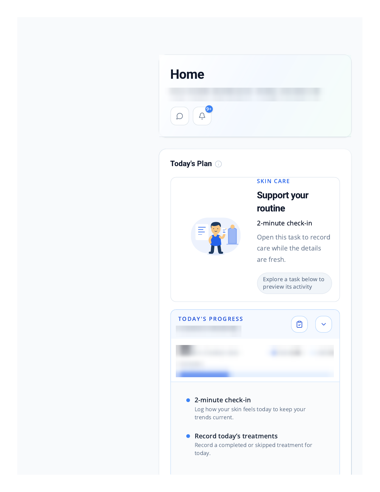
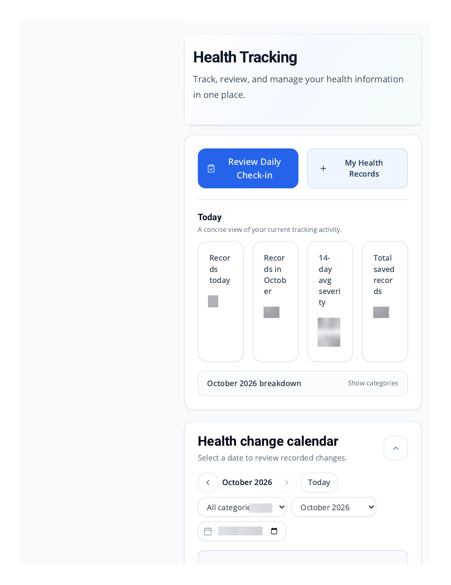
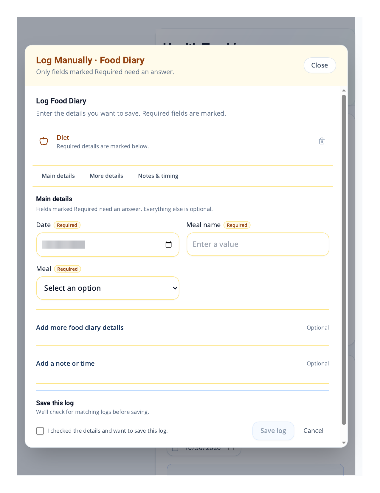
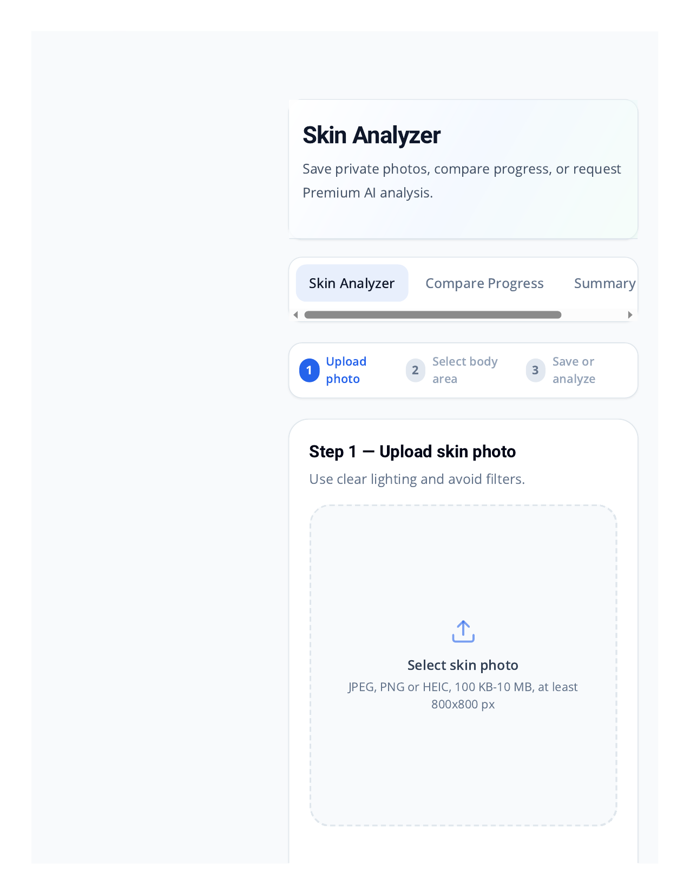
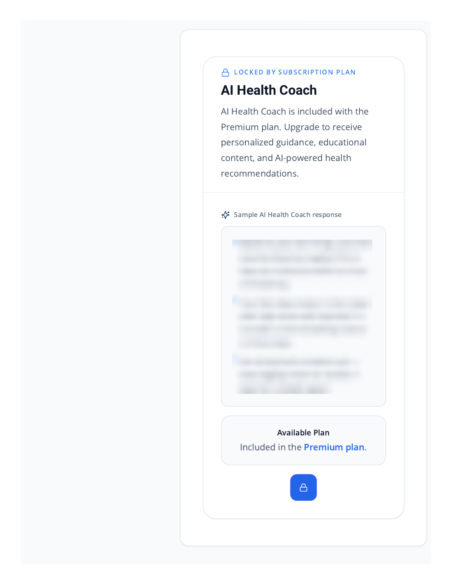
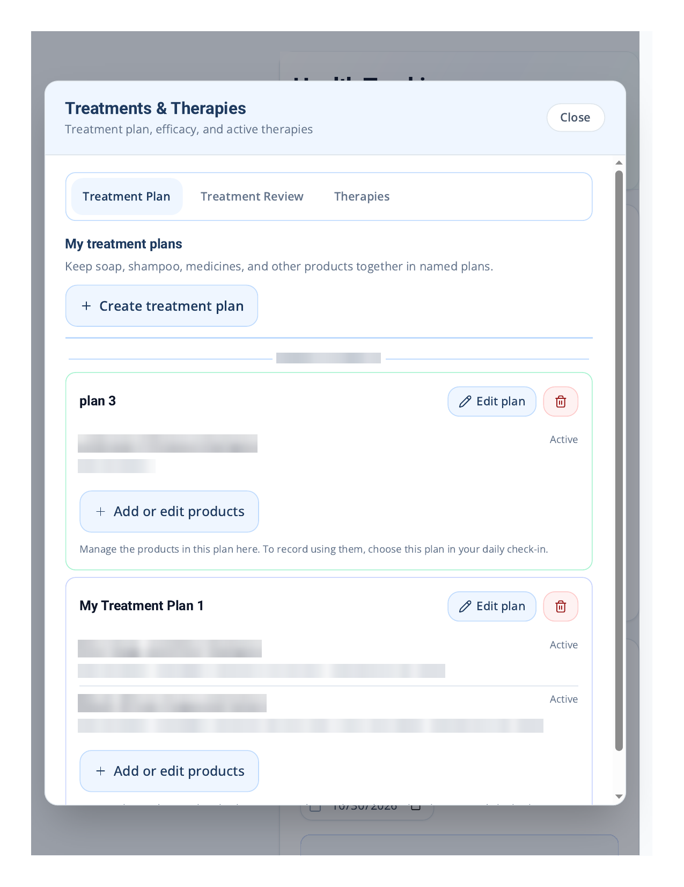
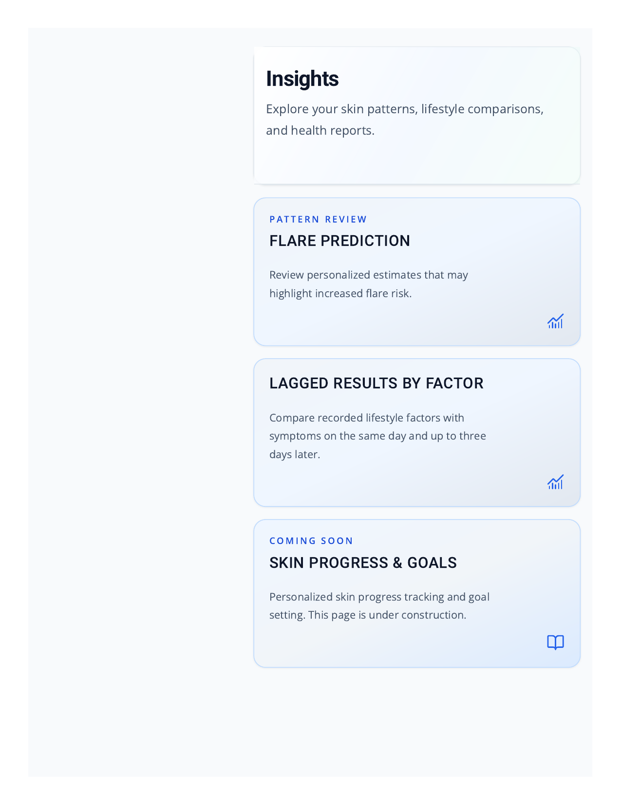
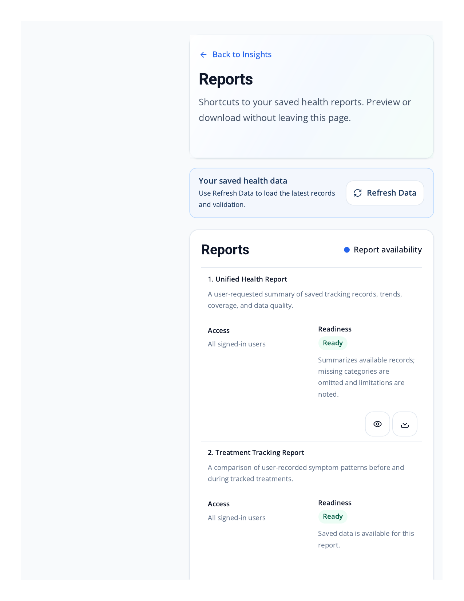
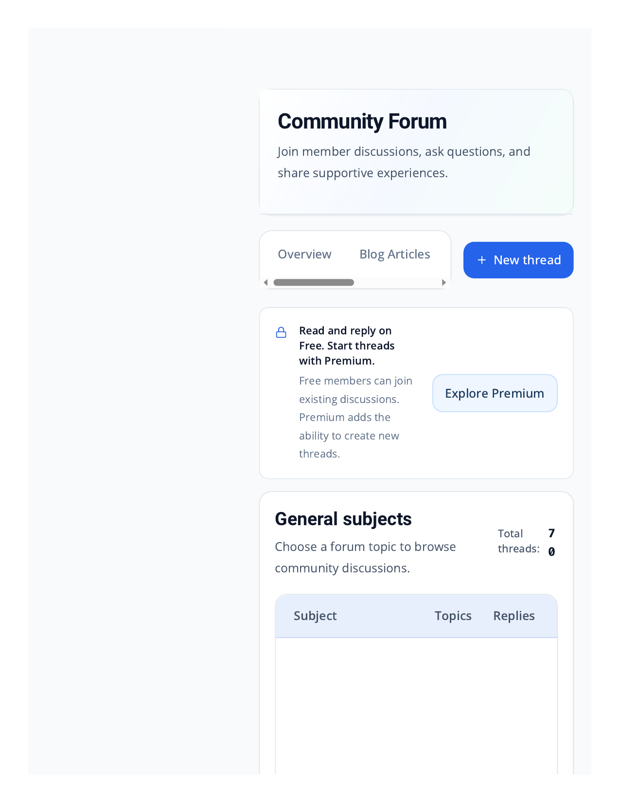
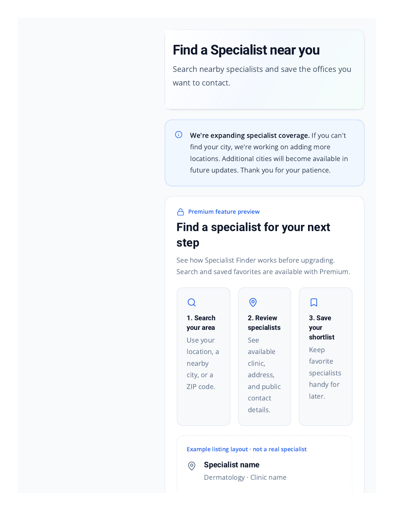

# PsoriCare.ai

PsoriCare.ai is a psoriasis care app that helps people track their condition day to day and understand what affects their skin.

Built with React and Vite.

## What it does

- **Symptom tracking** — log symptoms, flare-ups, and daily wellbeing
- **Food diary** — record meals and spot dietary patterns
- **Treatment tracking** — keep treatments and medication on schedule
- **Skin photos** — photograph affected areas over time and watch progress
- **Skin Analyzer** — assess skin by body zone, with per-zone history
- **AI Health Coach** — personalised guidance based on logged data
- **Insights & reports** — summaries and reports to share with a doctor
- **Community** — connect with other people living with psoriasis

## Screenshots

## Status

In active development. On the roadmap: a daily Skin Forecast, a photo timelapse view, and an improved body-zone map.

## Live app

👉 [psoricare.ai](https://psoricare.ai)

## About this repository

This public repository is a showcase only — it contains this README and app screenshots. The full source code lives in a private repository and is not published here.

Built by [SAVDEV Software Studio](https://savdev.org).
